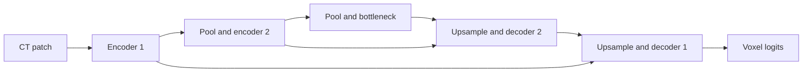

# First hands-on 3D U-Net experiment

This small model runs on CPU patches. It is a readable U-Net-style baseline,
not a reproduction of published NLSTseg results or a trained segmentation tool.



Skip connections retain encoder detail. A 1x1x1 output convolution produces
one logit per voxel. Sigmoid would map logits to probabilities; the model
does not threshold its output. Input and output are `[B,1,D,H,W]`.

With your environment active, run from the repository root:

```bash
python -m model.smoke_test --ct data/sample/ct.nii.gz --mask data/sample/mask.nii.gz --lesion-label 1 --patch-size 32 --steps 3
```

Replace paths and label ID using your own files and the provider's label
definitions. Choosing label 1 above is an example, not a universal rule.
The command uses the annotation to locate a positive patch, checks geometry,
normalizes CT values, and makes an explicit binary target for that selected
label. Other label IDs count as negative only in this limited experiment.
The original mask is not modified. HU scaling must be confirmed separately.

The command executes a forward pass, BCEWithLogitsLoss, backward pass, and
Adam update. BCE is an initial mechanics check, not a proven best loss. It
prints training-patch loss only. A decreasing loss does not establish lesion
accuracy, especially with mostly background voxels. No checkpoint is saved.

Next: verify sampling/label policy, create patient-disjoint partitions, and
plan patch-based training with validation Dice/IoU. Real scans are never
committed. This experiment has no UI, API, temporal analysis, or held-out score.
